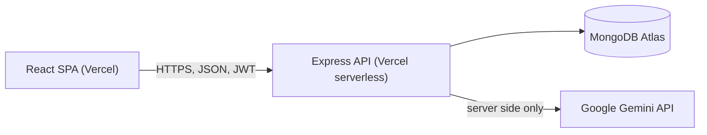
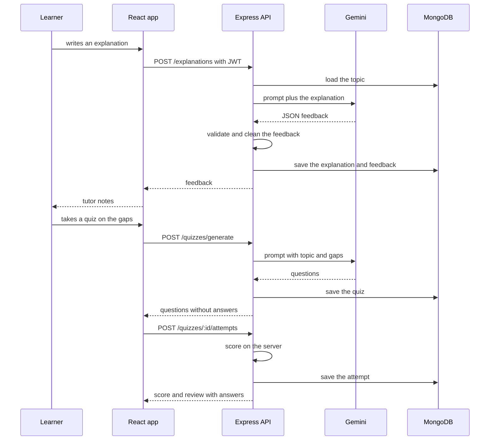
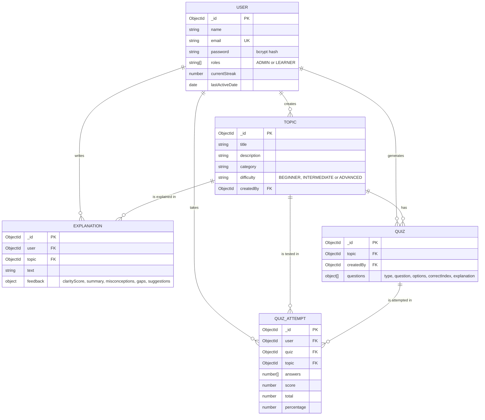

# SimplyTutor API

REST API for **SimplyTutor**, a micro-learning platform built on the **Feynman Technique**. Learners explain a concept in plain language, an AI tutor (Google Gemini) marks the explanation, finds the gaps, and generates a quiz around them. Progress, streaks and mastery are tracked per learner.

- **Live API:** https://simply-tutor-backend.vercel.app/api/v1/health
- **Live app:** https://simply-tutor-frontend.vercel.app
- **Frontend repo:** https://github.com/tesikaasemi2003/SimplyTutor-Frontend

## Features

- **Authentication and roles**: JWT access token (30 min) and refresh token (7 days), bcrypt password hashing, `LEARNER` and `ADMIN` roles.
- **AI Feynman evaluator**: scores clarity, lists misconceptions, knowledge gaps and suggestions.
- **Quiz generator**: Gemini writes MCQ and scenario questions aimed at the learner's gaps. Correct answers are hidden until the attempt is submitted, and scoring is done on the server.
- **Topic management**: admins create, update and delete topics. Learners browse them.
- **History**: learners review and delete their own explanations and quiz attempts.
- **Analytics**: daily learning streak, per-topic mastery, quiz trend and a 7-day activity summary.

## Tech stack

| Layer | Technology |
|---|---|
| Runtime and framework | Node.js, Express |
| Language | TypeScript |
| Database | MongoDB Atlas with Mongoose |
| Auth | JSON Web Tokens, bcryptjs |
| AI | Google Gemini API (server side only) |
| Hardening | helmet, express-rate-limit, CORS allow-list |
| Hosting | Vercel (serverless Express) |

## Architecture



The Gemini API key never reaches the browser. The React app only talks to this API.

### Core learning loop



### Request pipeline

```
request -> helmet -> CORS -> JSON body (20 kb) -> DB connection check
        -> rate limit (auth, AI) -> authenticate -> authorize -> controller
```

## Data model



## API reference

Base URL: `/api/v1`. Protected routes need `Authorization: Bearer <access token>`.

| Method | Path | Access | Description |
|---|---|---|---|
| GET | `/health` | Public | Health check |
| POST | `/auth/register` | Public | Create a learner account |
| POST | `/auth/login` | Public | Returns access and refresh tokens |
| POST | `/auth/refresh` | Public | New access token from a refresh token |
| GET | `/auth/me` | Logged in | Current user |
| GET | `/topics` | Logged in | List topics |
| GET | `/topics/:id` | Logged in | One topic |
| POST | `/topics` | Admin | Create a topic |
| PUT | `/topics/:id` | Admin | Update a topic |
| DELETE | `/topics/:id` | Admin | Delete a topic |
| POST | `/explanations` | Logged in | Submit an explanation and get AI feedback |
| GET | `/explanations/me?topic=<id>` | Logged in | My explanations, optionally for one topic |
| DELETE | `/explanations/:id` | Owner | Delete my explanation |
| POST | `/quizzes/generate` | Logged in | Generate a quiz for a topic |
| GET | `/quizzes/:id` | Logged in | Quiz questions without answers |
| POST | `/quizzes/:id/attempts` | Logged in | Submit answers, get score and review |
| GET | `/quizzes/attempts/me` | Logged in | My quiz attempts |
| DELETE | `/quizzes/attempts/:id` | Owner | Delete my attempt |
| GET | `/dashboard/me` | Logged in | Streak, totals, mastery, activity |

## Security

- Passwords are hashed with bcrypt, never stored or returned in plain text.
- Role checks run on the server (`authorize("ADMIN")`). The frontend guard is only a convenience.
- Deletes filter by owner (`{ _id, user }`), so a learner cannot delete someone else's data.
- Quiz correct answers are never sent before the attempt is submitted, and scoring happens on the server.
- AI output is validated and clamped before it is saved. Learner text is passed to the model as data inside delimiters, with an instruction to ignore commands inside it (prompt-injection mitigation).
- `helmet` security headers, a CORS allow-list from `CORS_ORIGIN`, a 20 kb body limit, and rate limits on auth and AI endpoints.
- Secrets live in environment variables only. `.env` is git-ignored.

## Project structure

```
src/
  index.ts            app setup, middleware, routes, cached DB connection
  controllers/        auth, topic, explanation, quiz, dashboard
  routes/             one router per resource
  middlewares/auth.ts authenticate and authorize
  models/             user, topic, explanation, quiz, quizAttempt
  services/           gemini.service.ts (evaluation and quiz generation)
  utils/              token.ts, streak.ts
```

## Getting started

Requirements: Node.js 20 or newer, a MongoDB Atlas cluster (or local MongoDB), a Gemini API key from Google AI Studio.

```bash
git clone https://github.com/tesikaasemi2003/SimplyTutor-Backend.git
cd SimplyTutor-Backend
npm install
cp .env.example .env     # on Windows PowerShell: Copy-Item .env.example .env
npm run dev
```

The server starts on `http://localhost:5000`. Check `http://localhost:5000/api/v1/health`.

### Environment variables

| Variable | Description |
|---|---|
| `PORT` | Local port (default 5000) |
| `MONGO_URL` | MongoDB connection string, including the database name |
| `JWT_SECRET` | Secret for access tokens (long random string) |
| `JWT_REFRESH_SECRET` | Secret for refresh tokens (a different long random string) |
| `GEMINI_API_KEY` | Google Gemini API key |
| `GEMINI_MODEL` | Gemini model name, for example `gemini-3.5-flash` |
| `CORS_ORIGIN` | Allowed frontend origin(s), comma separated, no trailing slash |

Generate a secret:

```bash
node -e "console.log(require('crypto').randomBytes(48).toString('hex'))"
```

### Scripts

| Script | What it does |
|---|---|
| `npm run dev` | Start with hot reload (tsx) |
| `npm run build` | Type-check and compile to `dist/` |
| `npm start` | Run the compiled build |

### Creating the first admin

Registration always creates a `LEARNER` (so nobody can sign up as an admin). To promote an account, open the `users` collection in MongoDB Atlas, change its `roles` to `["ADMIN"]`, then sign in again to get a new token.

## Deployment

The API runs on **Vercel** as a serverless Express app: the app is exported with `export default app`, and the MongoDB connection is cached and re-established if it goes stale. Set the environment variables above in the Vercel project, and allow the cluster to accept connections from Vercel (Atlas Network Access).

## Known limitations

- Rate limits use an in-memory store, so they are per serverless instance. A shared store such as Redis would make them exact.
- The first request after idle time is slower (cold start).
- Tokens are kept in `localStorage` on the client. `httpOnly` cookies would reduce XSS exposure.
